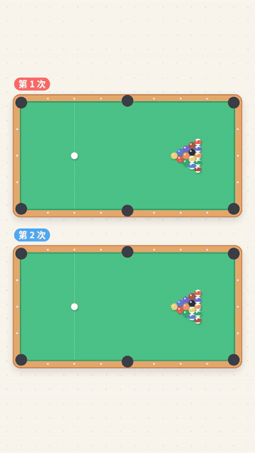

# 蝴蝶效应 · 竖屏短视频（抖音 / 视频号 / 小红书）

纯动画、无旁白、明亮风格，1080×1920 / 60fps。全片计划约 85 秒，这里是**第 1 部分（0–26 秒）**。



- 完整版（含背景音乐 + 音效）：[`out/part1_完整版_含音乐.mp4`](out/part1_完整版_含音乐.mp4)
- 仅音效版（方便在剪映里换平台音乐）：[`out/part1_仅音效版.mp4`](out/part1_仅音效版.mp4)
- 关键帧：[`out/preview/`](out/preview)

点开 mp4 后，右上角的下载按钮可以下载。

## 第 1 部分内容

| 时间 | 画面 | 屏幕文字 |
|---|---|---|
| 0–8s | 上下两张台球桌，同时开球，结果完全不同 | 同一杆，打两次 → 结果……不一样？ |
| 8–11s | 白球特写，两条瞄准线完全重合 | 其实，两杆只差了 0.001° |
| 11–14s | 蝴蝶标题卡 | 这叫「蝴蝶效应」 |
| 14–26s | 两个双摆，起点几乎一样，约 20 秒时分开 | 再看这两个摆 → 起点几乎一样 → 然后…… → 结局毫不相干 |

画面中的运动都是真实物理模拟的结果：两次开球、两个双摆的起始角度**确实只差 0.001°**，其余条件完全相同。音乐和音效全部由代码合成，没有版权问题；碰撞声的时间点来自物理模拟中真实发生的碰撞。

## 自己生成

```bash
pip install -r requirements.txt
python render.py                         # 生成 out/ 下的两个 mp4（约 1 分钟）
python render.py --stills 1.9 7.5 25.0   # 只导出指定时刻的关键帧
```

- 不需要单独安装 ffmpeg（`imageio-ffmpeg` 自带）
- Linux 上 `skia-python` 需要 `libEGL`（例如 `dnf install libglvnd-egl` 或 `apt install libegl1`）
- 字体优先用系统里的 Noto Sans SC；没有的话自动使用仓库 `fonts/` 里的字体

## 文件说明

| 文件 | 作用 |
|---|---|
| `billiards.py` | 台球开球的物理模拟 |
| `pendulum.py` | 双摆物理模拟（RK4） |
| `scenes.py` | 各个画面与时间轴 |
| `audio.py` | 合成背景音乐和音效 |
| `common.py` | 配色、字体、缓动、文字动画 |
| `render.py` | 渲染并输出 mp4 |
