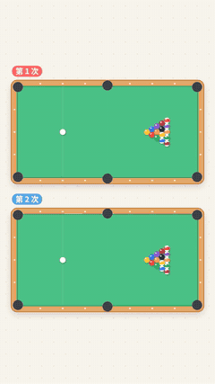

# 蝴蝶效应 · 竖屏短视频（抖音 / 视频号 / 小红书）

纯动画、无旁白、明亮风格，1080×1920 / 60fps，时长 **86 秒**。



- 有配乐版（背景音乐 + 音效）：[`out/蝴蝶效应_有配乐.mp4`](out/蝴蝶效应_有配乐.mp4)
- 无配乐版（只有音效，方便在剪映里配平台音乐）：[`out/蝴蝶效应_无配乐.mp4`](out/蝴蝶效应_无配乐.mp4)
- 关键帧：[`out/preview/`](out/preview)

点开 mp4 后，右上角的下载按钮可以下载。

## 分镜

| 时间 | 画面 | 屏幕文字 |
|---|---|---|
| 0–8s | 两张台球桌同时开球，结果完全不同 | 同一杆，打两次 → 结果……不一样？ |
| 8–11s | 白球特写，两条瞄准线重合 | 其实，两杆只差了 0.001° |
| 11–14s | 蝴蝶标题卡 | 这叫「蝴蝶效应」 |
| 14–26s | 两个双摆，起点几乎一样，后来分开 | 再看这两个摆 → 起点几乎一样 → 然后…… → 结局毫不相干 |
| 26–38s | 两个球在圆球之间反弹，实时显示两球距离，每次碰撞弹出放大倍数 | 为什么会这样？→ 秘密就在「圆」上 → 每撞一次，差距就放大好几倍 → 撞几次，就彻底分开了 |
| 38–49s | 慢动作抛两枚硬币，一个正面一个反面 | 再来抛两次硬币 → 一个正面，一个反面 → 硬币不是"随机"的 |
| 49–60s | 香的烟：下面笔直，上面乱；接着是天气预报卡片 | 近处：笔直一条线 → 远处：乱成一团 → 天气，也是这样 → 所以天气预报，最多准两周左右 |
| 60–70s | 上下对比：扔石头 vs 撞圆球，起点都差 2° | 但，不是所有事都这样 → 关键看：差距会不会被放大 |
| 70–79s | 蝴蝶周围冒出越来越多的小漩涡 | 一只蝴蝶，能掀起一场风暴吗？→ 其实，不是它一只 → 无数微小的差别，让未来算不准 |
| 79–86s | 回到开头的两张台球桌 | 规律是确定的，未来却算不准 → 你还见过哪些「蝴蝶效应」？ |

## 画面里的数字都是算出来的

- **台球开球、双摆、反弹球**：都是物理模拟，两次的起始角度确实只差 0.001°，其他条件完全相同
- **反弹球的 ×13、×22、×15**：是模拟中每次碰撞后两球距离真实放大的倍数
- **硬币**：两枚硬币的转速分别是每秒 38 圈和 39 圈，相差约 2.6%，所以字幕写"约 3%"
- **扔石头 vs 撞圆球**：两边的起始角度都差 2°
- **香的烟**：示意动画，不是流体模拟

音乐和音效全部用代码合成，没有版权问题。碰撞声的时间点来自物理模拟中真实发生的碰撞。

## 自己生成

```bash
pip install -r requirements.txt
python render.py                         # 生成 out/ 下的两个 mp4（约 3 分钟）
python render.py --stills 5.0 31.0 84.0  # 只导出指定时刻的关键帧
```

- 不需要单独安装 ffmpeg（`imageio-ffmpeg` 自带）
- Linux 上 `skia-python` 需要 `libEGL`（例如 `dnf install libglvnd-egl` 或 `apt install libegl1`）
- 字体优先用系统里的 Noto Sans SC；没有的话自动使用仓库 `fonts/` 里的字体

## 文件说明

| 文件 | 作用 |
|---|---|
| `billiards.py` | 台球开球的物理模拟 |
| `pendulum.py` | 双摆物理模拟（RK4） |
| `bumper.py` | 球在圆球之间反弹（精确碰撞计算） |
| `scenes.py` | 0–26 秒的画面 |
| `scenes2.py` | 26–86 秒的画面 |
| `video.py` | 总时间轴与转场 |
| `audio.py` | 合成背景音乐和音效 |
| `common.py` | 配色、字体、缓动、文字动画 |
| `render.py` | 渲染并输出 mp4 |
