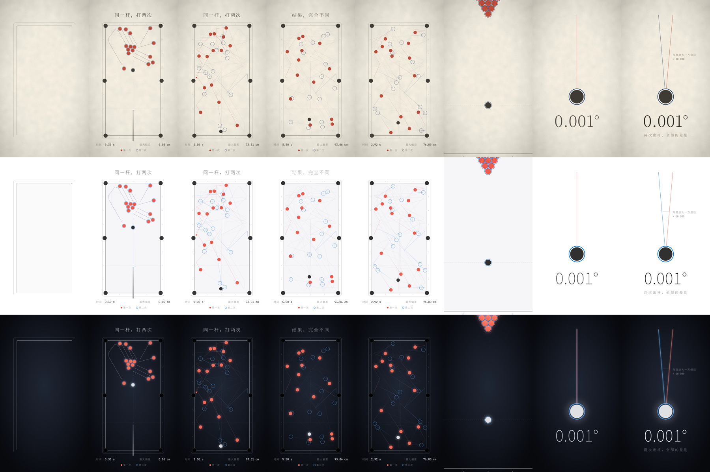

# 蝴蝶效应 · 全片（纸张风格，60 秒）

成片：[`全片_纸张_有配乐.mp4`](out/全片_纸张_有配乐.mp4)。竖屏 1080×1920 / 60fps，60.4 秒，点开后右上角可以下载。

| 时间 | 画面 | 文字 |
|---|---|---|
| 0–12.4s | 台球开场（就是下面的试片，原样保留） | 同一杆，打两次 / 结果，完全不同 / 0.001° |
| 12.4–24.4s | 两个双摆长曝光，红蓝从重合到分离 | 起点相同。终点无关。 |
| 24.4–30.4s | 铜版画线描风格的硬币，慢动作翻转，定格在正面 | 你以为的随机，只是算不清。 |
| 30.4–42.4s | 一缕香烟 → 镜头拉远变成云 → 地球上的台风 → 两条预报路径分叉 | 天气也是如此。超过两周，没人算得准。 |
| 42.4–60.4s | 两条光迹画出洛伦兹吸引子（蝴蝶形状），然后缓缓旋转、淡去 | 蝴蝶效应 / 世界遵守规则，却拒绝被预测。 |

## 画面里的数字从哪来

- **双摆**：真实物理模拟（`../butterfly_shorts/pendulum.py`）。两次放手时上臂角度只差 0.001°，其余完全相同。"最大偏差"是两个下摆球到目前为止的最大距离
- **硬币**：按一次普通抛硬币来算。空中 0.5 秒、每秒 38 圈，正好翻 19 圈，落下是正面；每秒 39 圈就是 19.5 圈，落下是反面。底部的"时间 / 已翻"按这个实时计算
- **台风和预报路径**：烟和台风云带是示意动画。地图用正射投影，海岸线来自 [Natural Earth](https://www.naturalearthdata.com/)（公共领域）。两条路径的基本走向是示意的，但它们**什么时候开始分叉、分得多开**，由下面两次洛伦兹方程计算的差距决定。"两条路径相距"是这个地球上两个路径终点之间的实际球面距离
- **洛伦兹吸引子**：数值求解洛伦兹方程（σ=10，ρ=28，β=8/3，RK4）。两次计算的起点 x 分别是 0.506127 和 0.506，这是向洛伦兹 1961 年的发现致敬：他重算天气时把 0.506127 简写成 0.506，结果完全不同

## 配乐

全片沿用开场的钢琴和弦乐样本，都是 A 小调、72 拍。每一段里成对出现的东西都会**自己演奏**：两个双摆按高度弹旋律，硬币每翻半圈响一个音（越转越慢，像八音盒停下来），两条预报路径每天按纬度弹一个音，两条洛伦兹光迹每次换翼时响一声。每一对一开始都同声奏响，然后慢慢错开。蝴蝶出现时，开场的分解和弦再次响起，全片最后收在 A 小调上。

发布时请在简介里注明音色来源（见下面"音乐"一节）。地图数据来自 Natural Earth，属于公共领域，不需要署名。

## 自己生成

```bash
pip install -r requirements.txt
python make_film.py                      # 生成全片（约 5 分钟）
python make_film.py --stills 26 36 50    # 导出指定时刻的关键帧
python make_film.py --range 30 43        # 只渲染一段（无声），快速预览
python make_film.py --audio-only         # 只生成配乐 wav
```

首次运行会自动下载乐器样本和海岸线数据（约 4.5 MB），缓存在 `assets/` 目录。

| 文件 | 作用 |
|---|---|
| `film.py` | 全片时间轴：开场之后，各段依次接上 |
| `pendulum_scene.py` | 12.4–24.4s 双摆 |
| `coin_scene.py` | 24.4–30.4s 硬币 |
| `weather_scene.py` | 30.4–42.4s 烟 → 云 → 台风 → 预报路径 |
| `lorenz_scene.py` | 42.4–60.4s 洛伦兹吸引子 |
| `lorenz.py` | 洛伦兹方程求解（天气段和吸引子段共用） |
| `film_common.py` | 字幕、底部数据栏、图例（和开场的位置、字号完全一致） |
| `score.py` | 全片配乐和音效（开场部分和 `music.py` 完全相同） |
| `make_film.py` | 渲染全片 |

---

# 蝴蝶效应 · 新风格试片（开场 12 秒）

同一段开场，做了三种风格，用来选定全片的风格。竖屏 1080×1920 / 60fps。



从上到下依次是：纸张、纯白、深色。

| 风格 | 有配乐 | 无配乐（只有音效） |
|---|---|---|
| 纸张 | [`开场_纸张_有配乐.mp4`](out/开场_纸张_有配乐.mp4) | [`开场_纸张_无配乐.mp4`](out/开场_纸张_无配乐.mp4) |
| 纯白 | [`开场_纯白_有配乐.mp4`](out/开场_纯白_有配乐.mp4) | [`开场_纯白_无配乐.mp4`](out/开场_纯白_无配乐.mp4) |
| 深色 | [`开场_深色_有配乐.mp4`](out/开场_深色_有配乐.mp4) | [`开场_深色_无配乐.mp4`](out/开场_深色_无配乐.mp4) |

## 开场内容

| 时间 | 画面 |
|---|---|
| 0–2s | 球桌线条一笔画出，球杆蓄力 |
| 2–8s | 同一张桌上叠着两次开球：实心球是第一次，空心圈是第二次。前 1 秒完全重合，之后分开。虚线连着同一颗球在两次里的位置，底部实时显示最大偏差 |
| 8–9s | 时间倒流回出杆瞬间 |
| 9–10s | 镜头推近白球，两条瞄准线完全重合 |
| 10–12s | 画面中出现 0.001°。随后把角度放大一万倍，两条线才分开 |

两次开球的唯一区别，就是出杆角度相差 0.001°，其余物理条件完全相同（物理模拟见 `../butterfly_shorts/billiards.py`）。

## 音乐

- 钢琴：**Salamander Grand Piano V2**（Yamaha C5 录音），作者 Alexander Holm，[CC BY 3.0](https://creativecommons.org/licenses/by/3.0/)，样本来自 [Tonejs/audio](https://github.com/Tonejs/audio/tree/master/salamander)
- 弦乐、大提琴：**FluidR3 GM** 音色库，作者 Frank Wen，[CC BY 3.0](https://creativecommons.org/licenses/by/3.0/us/)，样本来自 [gleitz/midi-js-soundfonts](https://github.com/gleitz/midi-js-soundfonts)
- 两者都允许商用。发布视频时请在简介里注明来源，例如：「钢琴音色：Salamander Grand Piano（Alexander Holm, CC BY 3.0）；弦乐音色：FluidR3 GM（Frank Wen, CC BY 3.0）」
- 编曲和音效由代码生成。碰撞声的时间点取自物理模拟中真实发生的碰撞

## 自己生成

```bash
pip install -r requirements.txt
python render.py                       # 三种风格 × 有/无配乐，共 6 个 mp4（约 2 分钟）
python render.py --theme dark          # 只生成一种风格
python render.py --stills 3.0 11.5     # 只导出关键帧
```

首次运行会自动下载约 4 MB 的乐器样本，缓存在 `assets/` 目录。宋体使用系统里的 Noto Serif CJK，没有的话会自动改用仓库里的黑体。

| 文件 | 作用 |
|---|---|
| `theme.py` | 三种风格的配色、字体、背景纹理 |
| `opening.py` | 开场画面与时间轴 |
| `music.py` | 钢琴和弦乐编曲、音效、混响 |
| `samples.py` | 下载并读取乐器样本 |
| `render.py` | 渲染并输出 mp4 |
