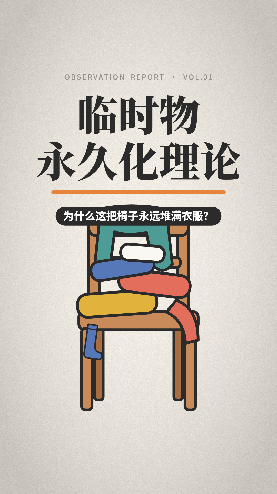

# 日常科普：临时物永久化理论

> 没有什么，比临时方案更持久。

伪纪录片风格的日常科普短视频，竖屏 1080×1920 / 30fps / 2分39秒。画面、配音、配乐和字幕全部由代码生成，适合发抖音、视频号、小红书、B站。



- 成片：[`out/linshiwu_9x16.mp4`](out/linshiwu_9x16.mp4)（点开后点右上角的下载按钮）
- 字幕：[`out/linshiwu.srt`](out/linshiwu.srt)
- 关键帧：[`out/preview/`](out/preview)

## 内容结构

| 段落 | 画面 |
|---|---|
| 开场 | 取景框 + REC，一把堆满衣服的椅子 |
| 观察 | 「居所常见物种图鉴」，6 张标本卡先盖「临时」章，再改盖「永久」章 |
| 命题 | 词典词条，然后逐字打出「没有什么，比临时方案更持久」 |
| 第一定律·够用即终点 | 「改变的动力」曲线：临时方案出现后断崖下跌 |
| 第二定律·习惯的吸引力 | 衣物绕椅子公转；衣柜 → 中转站 → 洗衣篮；清空后衣服无家可归 |
| 第三定律·标签豁免 | 正式物品被挑剔，临时通知被盖上「免检」章 |
| 推论·临时物会繁殖 | 袋中袋种群数量 1 → 2 → 4 → 8 |
| 结论 | 晃动的桌子被一张纸垫稳，镜头推近那张纸 |
| 结尾 | 「你家里的『先这样吧』是什么？」 |

## 自己生成

```bash
pip install -r requirements.txt
python make_video.py all                     # 配音 + 混音 + 渲染 + 字幕 + 封面，输出到 out/
python make_video.py preview law1@0.6 12.5   # 导出关键帧（场景@进度 或 秒数）
```

需要另外准备两样东西：

1. **离线配音模型** [kokoro-multi-lang-v1_0](https://github.com/k2-fsa/sherpa-onnx/releases/download/tts-models/kokoro-multi-lang-v1_0.tar.bz2)（约 350MB）。解压后用环境变量 `TTS_MODEL_DIR` 指定路径，默认路径是 `/opt/tts/kokoro-multi-lang-v1_0`。旁白音色是 `zm_yunjian`（sid 49）。
2. **Noto Sans CJK / Noto Serif CJK 字体**（`.ttc`）。程序会自动在系统字体目录或 `./fonts` 里查找，也可以用 `CJK_FONT_DIR` 指定。

## 修改

- `content.py`：旁白文案，可以给每句单独设置字幕文字和朗读文字，另外还有音色和语速
- `scenes.py`：每个场景的动画，动画时间和旁白逐句对齐
- `gfx.py`：配色、字体和所有插画（椅子、塑料袋、遥控器、桌子等）

一句旁白如果读音不准，可以改用同义的说法，或者用 `(字幕, 朗读文本)` 的形式让字幕和朗读分开。
