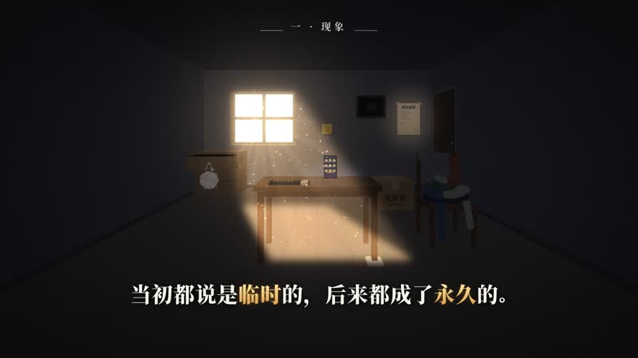

# 临时物永久化理论（16:9 横屏版）

全部用 Python 代码生成的科普短片：昏暗的 3D 房间、窗口照进来的暖光与灰尘，配金色高亮字幕。无配音，配乐是一首贯穿全片的钢琴 + 弦乐曲，同样由代码合成。



- 成片：[`out/linshiwu_16x9.mp4`](out/linshiwu_16x9.mp4)（1920×1080 / 30fps / 2:32.8，点开后右上角可下载）
- 关键帧：[`out/preview/`](out/preview)

## 自己生成

```bash
pip install -r requirements.txt
python music.py    # 合成配乐 -> build/music.wav（约 30 秒）
python render.py   # 渲染画面并合成音频 -> out/linshiwu_16x9.mp4（8 核约 6 分钟）
python render.py still 9.5 47 120   # 只导出指定秒数的静帧到 build/stills/，用来快速检查画面
```

不需要单独安装 ffmpeg（`imageio-ffmpeg` 自带）。

## 文件说明

| 文件 | 内容 |
|---|---|
| `scenes.py` | 分镜表：每个镜头的机位、时长、字幕（`[..]` 内为金色高亮词）、章节名；`SPEED` 统一缩放总时长 |
| `room.py` | 程序化绘制房间与道具（椅子、塑料袋、遥控器、垫桌腿的纸、手机、纸箱、标签等）和光照 |
| `render.py` | 逐帧合成：镜头推进、光束灰尘、转场、字幕动画、暗角与颗粒；多进程分段编码 |
| `music.py` | C 大调钢琴 + 弦乐配乐，一首完整的曲子贯穿全片 |

## 字体

`fonts/` 内为 [Noto Serif SC / Noto Sans SC](https://github.com/notofonts/noto-cjk)，SIL Open Font License。
