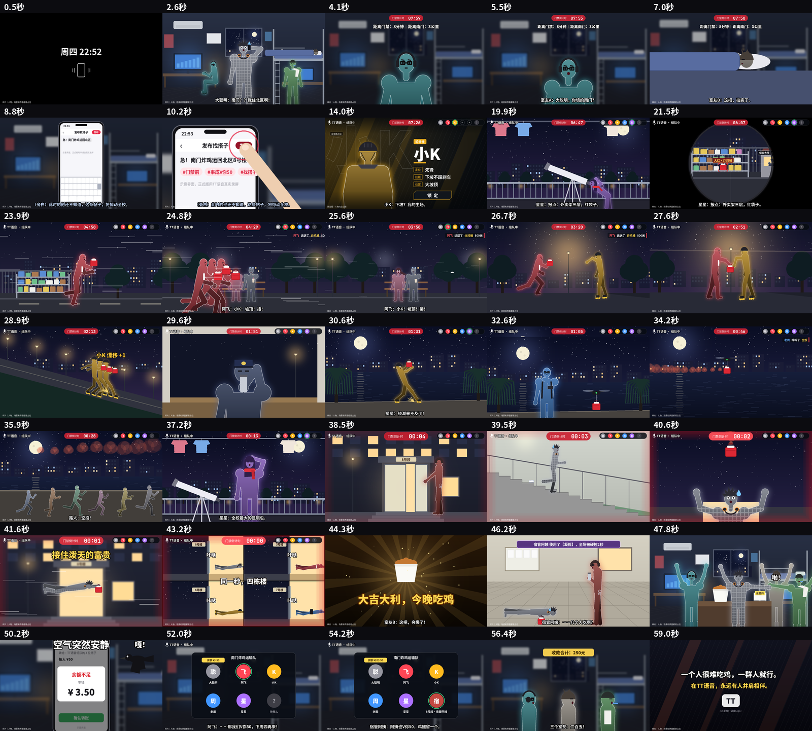
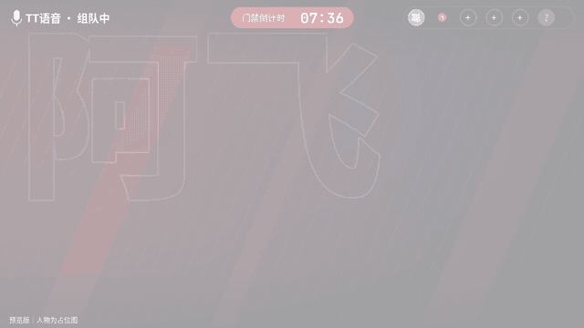

# 《事成V你50》

TT语音「你与搭子的群像故事」参赛短片（60 秒）。周四晚上，大聪明把炸鸡外卖填到了南门，离门禁只剩 8 分钟。他在 TT 语音发帖找搭子："事成V你50"。四个社团的陌生人锁定进房，跑的跑，滑的滑，飞的飞，把一桶炸鸡接力运回了宿舍。

## 60 秒样片

- 成片：[`sample_60s.mp4`](sample_60s.mp4)（60 秒，1280×720，30 fps，有声音）
- 关键帧：[`sample_60s_keyframes.png`](sample_60s_keyframes.png)
- 代码：[`render_sample_60s.py`](render_sample_60s.py)（镜头和叠加）、[`sample_figures.py`](sample_figures.py)（小人）、[`sample_scenes.py`](sample_scenes.py)（场景和界面）、[`sample_audio.py`](sample_audio.py)（台词、音效、配乐、混音）



这是动态分镜样片，用来看节奏、笑点和镜头顺序：人物、场景和手机/TT 界面都是代码画的占位，正式版换成 AI 画面和 TT 语音真实录屏；台词用 edge-tts 在线 AI 配音；音效和配乐都由代码合成。11～19 秒直接用下面的选英雄卡。

| 时间 | 内容 |
|---|---|
| 0～7.4 秒 | 周四 22:52，炸鸡放南门；三个室友三连回头，"这把，拉完了" |
| 7.4～11 秒 | 发帖"事成V你50"，旁白：此时的他还不知道…… |
| 11～19 秒 | 选英雄卡：阿飞、小K、老周、星星锁定，大聪明锁定失败 |
| 19～38 秒 | 望远镜报点 → 阿飞冲刺 → 坡顶交接 → 小K漂移 → 湖边急刹 → 无人机空投过湖 |
| 38～45 秒 | 门禁前 5 秒：宿管关门、冲下楼、接住泼天的富贵、四栋楼同时飞扑、大吉大利今晚吃鸡 |
| 45～57.4 秒 | 宿管凝视、开吃、余额 3.50、大家反过来 V 他 50、神秘人是宿管阿姨、收款合计 250 |
| 57.4～60 秒 | 一个人很难吃鸡，一群人就行。在TT语音，永远有人并肩相伴。 |

## 11～19 秒选英雄卡预览

四个陌生人在 TT 语音房间里组队，像无畏契约选英雄一样一张张"锁定"。最后一张是大聪明，锁定失败，一只乌鸦飞过。



- 成片：[`hero_select_11-19s.mp4`](hero_select_11-19s.mp4)（8 秒，1280×720，30 fps，有声音）
- 无声 GIF：[`hero_select_11-19s_silent.gif`](hero_select_11-19s_silent.gif)
- 关键帧：[`hero_select_11-19s_keyframes.png`](hero_select_11-19s_keyframes.png)
- 代码：[`render_hero_select.py`](render_hero_select.py)

| 卡 | 成片时间 | 台词 |
|---|---|---|
| 阿飞（田径队） | 11.0～12.8 秒 | V我50，真的假的？ |
| 小K（轮滑社） | 12.8～14.6 秒 | 下坡？我的主场。 |
| 老周（航模社） | 14.6～16.0 秒 | 50块，够买俩桨。 |
| 星星（天文社） | 16.0～17.8 秒 | 钱不要，鸡翅留一个。 |
| 大聪明（501寝室） | 17.8～19.0 秒 | （乌鸦叫） |

## 自己生成

```bash
pip install numpy pillow imageio-ffmpeg edge-tts
python shicheng_v50/render_sample_60s.py              # 60 秒样片 + 关键帧
python shicheng_v50/render_sample_60s.py --preview    # 只出关键帧拼图，几秒钟
python shicheng_v50/render_hero_select.py             # 只出 11～19 秒选英雄卡
```

在仓库根目录运行。配音需要联网，生成后缓存在 `shicheng_v50/.assets/`，已被 `.gitignore` 忽略。字体用仓库 `fonts/` 里的 Noto Sans SC 和 JetBrains Mono。
